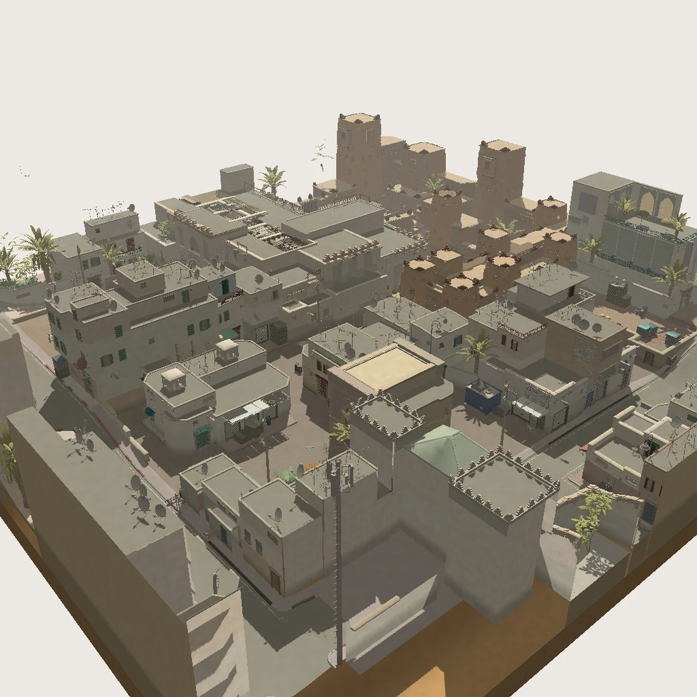

# Dust II — The Living Map

用鼠标环绕、切换地标，或以第一人称走进 Dust II 的街巷与隧道。支持中英双语。

**[在线体验](https://dust2.ak1na.com/) · [Ak1na 主站](https://ak1na.com/)**



预览图由项目同一套场景几何和 WGSL 着色器在原生 GPU 上离屏渲染，展示地图场景，不包含浏览器界面。

## 操作

- 左键拖动：绕地图中心旋转；右键、中键或 Shift＋左键：平移。
- 滚轮：缩放；双击表面：聚焦；自转按钮：连续环绕查看。
- 地标选择：进入指定区域；蓝图与沙盘可切换。
- 漫游：WASD 移动，Shift 加速，空格跳跃，鼠标查看，Esc 释放鼠标。
- 三条路线导览、光照切换、小地图与中英切换。

当前版本专注地图探索，不含人物或对战功能。

## 本地运行

安装 Node.js，在此目录执行：

```sh
node preview.mjs
```

打开 `http://127.0.0.1:4183/`。无需安装 npm 依赖。WebGPU 需要兼容浏览器、可用的图形驱动，以及 HTTPS 或 localhost 安全上下文；直接双击 HTML 不作为推荐运行方式。

## 实现与文件

- `index.html`：可直接部署的约 26 MB 单文件，内嵌原生 WebGPU / WGSL 渲染器、压缩地图几何、纹理图集、导航数据和 Meshoptimizer 解码器。
- `preview.mjs`：仅监听本机的静态预览服务。
- `assets/preview.webp`：项目场景预览。
- `THIRD_PARTY_NOTICES.md`：第三方来源、许可及非官方作品说明。

运行时不请求外部字体、模型、纹理或 CDN 脚本。首次加载会下载整个 HTML，并在本机解码和创建 GPU 缓冲；性能取决于设备与 WebGPU 支持。本仓库保存可运行交付文件，不包含游戏安装文件、原始导出工程、开发历史或服务器凭据。线上站点托管于自有 VPS，仓库不依赖 GitHub Pages。

## 来源与使用范围

这是个人非商业的地图交互展示作品，与 Valve 无隶属关系。Counter-Strike、Dust II 及游戏地图内容属于 Valve；相关游戏内容不因本仓库公开而获得开源许可。请遵守 [Steam 订户协议第 2.D 节](https://store.steampowered.com/subscriber_agreement/#2) 的非商业 Fan Art 条款及其他适用条款。

项目自有代码未另行附加开源许可证；公开查看不代表额外授予修改、再分发或商业使用许可。Meshoptimizer 的独立 MIT 许可见第三方说明。
